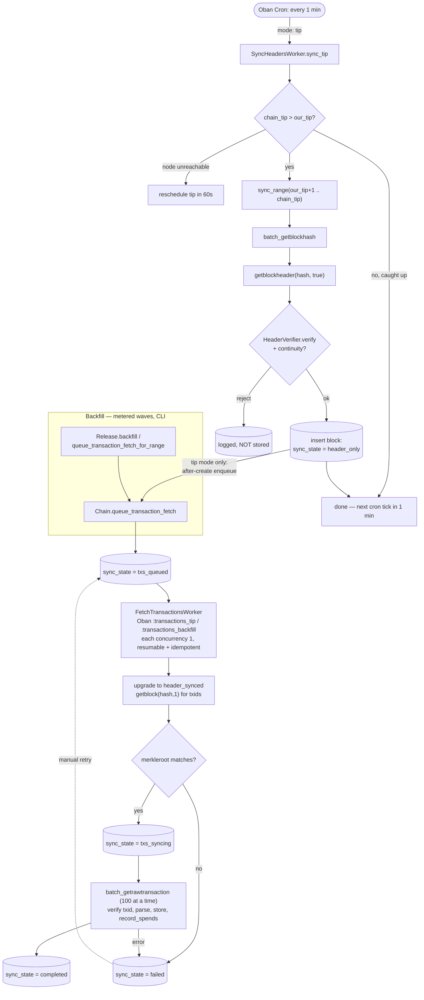
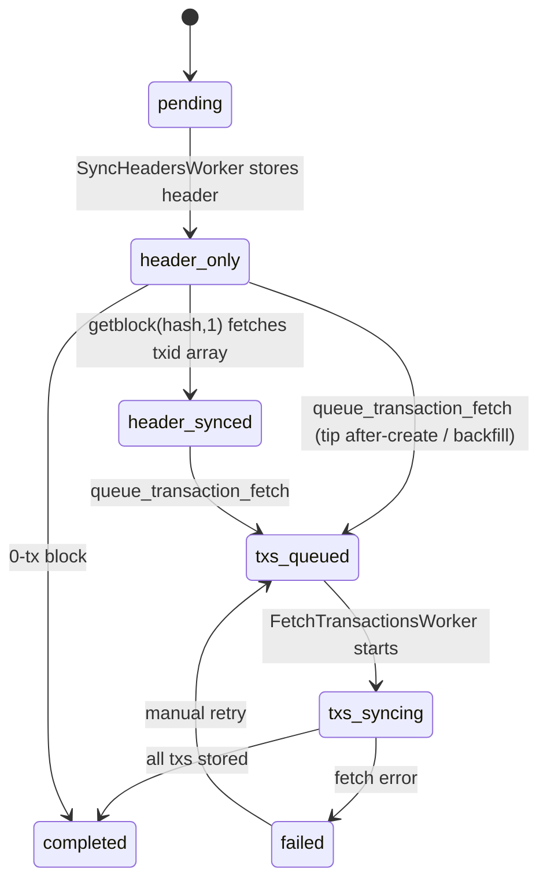

# Syncing

The single source of truth for how Bitblocks syncs the chain.
Consolidated from the code (authoritative) and the older scattered docs.
Where the prose docs disagreed with the code, **the code wins** — corrections are called out inline.

Related: `docs/SYSTEM_ARCHITECTURE.md` (Oban queues, background services, RPC sizing), `docs/LARGE_BLOCKS.md` (mega-block handling), `docs/PERFORMANCE.md` (RPC batching).

---

## The two phases of data

A block is acquired in two stages, tracked by `block.sync_state`:

1. **Headers** — cheap (~400 bytes via `getblockheader`). Establishes that the block exists and where it sits in the chain.
2. **Transactions** — expensive (per-tx `getrawtransaction`, batched). Fills in the block's bodies.

`sync_state` string values (`lib/bitblocks/chain/block.ex`):

| State | Meaning |
|---|---|
| `pending` | initial, pre-header |
| `header_only` | header stored; no txid array yet |
| `header_synced` | header + txid array present; ready for tx fetch |
| `txs_queued` | a tx-fetch job has been enqueued |
| `txs_syncing` | tx fetch in progress |
| `completed` | all txs stored (or block has 0 txs) |
| `failed` | tx fetch failed (retryable) |

---

## The three movers (and why they collide)

There are **three** independent things that can advance a block. They do **not** coordinate.

| Mover | Kind | Trigger | Does |
|---|---|---|---|
| `SyncHeadersWorker` (tip mode) | Oban cron, every 1 min | automatic | inserts new headers **and** enqueues a tx fetch for each → keeps the tip fully synced hands-off |
| `SyncHeadersWorker` (range mode) | Oban job | manual / backfill | inserts **headers only** for a height range; does **not** enqueue tx fetches (the hourly backfill cron picks them up) |
| `FetchTransactionsWorker` | Oban `transactions_tip` queue (concurrency 1) | enqueued by tip mode per new block | fetches that block's txs → `completed`; diff-and-fill, resumable + idempotent |
| `BackfillTransactionsWorker` | Oban `transactions_backfill` queue (concurrency 1) | hourly cron + `Release.start_backfill_transactions()` + `/sync` Repair | walks the lowest incomplete block, fills only its missing txs, self-reschedules — slow and steady, one block at a time |

> **The after-create model.** Storing a header is the `create`; the enqueued `FetchTransactionsWorker` is the `after_create` job that batch-fetches that block's transactions. Tip mode wires this automatically (`sync_headers_worker.ex` — `sync_range/3` with `enqueue_txs? = true`). Range/backfill mode passes `false` so a bulk backfill doesn't flood `oban_jobs`; the **hourly `BackfillTransactionsWorker` cron** is the safety net that guarantees range-synced headers eventually get their transactions with zero manual steps.

> **Lane roles.** The tip lane (`transactions_tip`) carries per-block jobs for newly confirmed blocks — low latency, bounded volume. The historical lane (`transactions_backfill`) is owned by the **sequential** `BackfillTransactionsWorker` exclusively. The lanes never share slots, so the tip is never starved and historical fill can't compete with it.

> **`SyncServer` was removed**, and the wave-based `Release.backfill_transactions/1` enqueuer is **deprecated** (it flooded per-block jobs and skipped `txs_queued`/`txs_syncing` orphans). The sequential worker replaced both.

### The shared integrity core

Both tx movers now derive "what should this block contain" from `Chain.TxidSource` and store through `Chain.TxIngest`:

- **`TxidSource.expected_tx_count/1`** — the completeness denominator is the header's `num_tx` (PoW-verified), never `length(block.tx)`. Previously a block with a truncated/empty stored array (the >10k memory optimization) had `total = 0`, passed the gate trivially, and was marked `completed` with **zero transactions stored**.
- **`TxidSource.txids/1`** — uses the stored array only when complete; otherwise re-fetches the txid list via `getblock(hash, 1)` into process memory (never persisted above 10k). Every list — stored or fetched — is **merkleroot-verified** (this also closed the skipped-merkle hole for large blocks). A verified list self-heals the row (`num_tx` corrected, small arrays persisted).
- **`TxIngest.store/2`** — single ingest path: body-hash check (T4), `analyze`, insert (`on_conflict: :nothing`), `record_spends`, `index_tokens`. The backfill lane previously skipped the body check and token indexing.
- **No completion without proof** — both workers re-count stored rows against the verified list and refuse to mark `completed` on a shortfall.

---

## What actually happens today (the real flow)



### State machine



---

## Key parameters (from code, authoritative)

| Thing | Value | Source |
|---|---|---|
| Tip cron | every 1 min (`* * * * *`) | `config.exs` Oban crontab |
| Backfill cron | hourly (`0 * * * *`), no-op when nothing incomplete | `config.exs` Oban crontab |
| Tip self-reschedule | **none in steady state** — cron is the only scheduler; 60 s backoff only when the node is unreachable | `sync_headers_worker.ex` `reschedule_tip/1` |
| Backfill gap between blocks | 15 s (`:backfill_reschedule_seconds`) | `backfill_transactions_worker.ex` |
| Backfill retry budget per block | 3 (`:backfill_max_attempts`), then skipped until `Release.retry_failed_blocks/0` | `backfill_transactions_worker.ex` |
| Header range batch | 500 (`@batch_size`) | `sync_headers_worker.ex:27` |
| Tx fetch batch | 100 (`:tx_fetch_batch_size`) | `fetch_transactions_worker.ex` |
| `transactions_tip` / `transactions_backfill` concurrency | **1 each** (separate lanes) | `config.exs` / `prod.exs` |
| `blocks` queue concurrency | prod **1**, dev 3 | `prod.exs` / `config.exs` |
| FetchTx retries | 5; unique per `block_hash` / 300 s | `fetch_transactions_worker.ex` |
| SyncHeaders retries | 3 | `sync_headers_worker.ex` |
| Tip source | `RpcCache.get_blockchain_info()["blocks"]` (**10-min TTL**) | `sync_headers_worker.ex:106` |
| Our tip | `Chain.get_latest_block().height` | `sync_headers_worker.ex:112` |
| Large blocks | tx arrays > 10k not stored on the row; txid list re-fetched transiently at sync time | `chain.ex` / `chain/txid_source.ex` / see `LARGE_BLOCKS.md` |

> **Note on the tip source TTL.** `chain_tip` is read from `RpcCache`, which caches `getblockchaininfo` for 10 minutes. So tip detection can lag the node by up to ~10 min even when everything is healthy. This is fine for steady-state but means "caught up" is measured against a slightly stale tip.

---

## Failure modes (how syncing silently stops)

These are the realistic ways the chain stops advancing — useful when diagnosing a stall (e.g. "indexed tip is 21h behind the node"):

1. **A wedged Oban job suppresses the cron.** Tip jobs are `unique` on args within a window; a job stuck `executing` (e.g. blocked on a hung RPC) can cause new cron inserts to be no-ops until it clears.
2. **Header verification rejects at a boundary.** `HeaderVerifier.verify` / continuity rejects a header (PoW, hash mismatch, or `prevhash` not matching the predecessor we hold). It's logged and **not stored**, so `our_tip` never advances past that height — and since tx-fetch is enqueued per *stored* header, tx fetching stops there too.
3. **Persisted Oban backlog re-fires on boot.** `available`/`scheduled`/`retryable` jobs are durable. A big backlog queued via `/sync` re-runs on every app restart — this is the likely cause of "some jobs start on boot." (Mitigated now that `SyncServer` is gone and tip enqueues are bounded, but a previously-queued backfill backlog still persists.)

> *Historical:* before tip mode enqueued tx fetches, headers advanced but transactions never auto-fetched — blocks sat at `header_only` unless `/sync` or the old `SyncServer` was driven manually. This was the original cause of the indexed tip lagging the node. Fixed by the tip after-create enqueue.

### Completeness audit & repair ✅ implemented

`sync_state = "completed"` is no longer the only word — the audit compares actual transaction rows to the header's `num_tx` for every block, in any state:

```
Release.audit_completeness()              # list deficit blocks (limit: 1_000 default)
Release.repair_incomplete_blocks()        # reset deficits → sequential backfill fills the gaps
Release.status(audit: true)               # status one-liner + deficit count
```

Both are also on `/sync` ("Completeness Audit" card: Run Audit / Repair buttons).

- The audit is one GROUP-BY join over `transactions` — heavy enough to be on-demand, cheap enough to run daily.
- The count is by `block_hash`, so a txid stored under another block's hash (reorg, BIP30 dup coinbase) makes it a **lower bound**: the audit may flag a block that the worker's txid-intersection check completes without fetching. Repair is idempotent, so false positives cost one no-op pass.
- Repair covers **all** states — `completed`-with-deficit, `failed`, `header_*`, and `txs_queued`/`txs_syncing` orphans whose Oban job was lost (blocks with a live fetch job are skipped). `recover_stuck_blocks/0` is deprecated and delegates here.
- The sequential worker also picks up orphaned `txs_queued` blocks by itself (`next_incomplete_block` checks for a live job), so orphans self-heal even without running repair.

### Runbook: finding and fixing missing transactions

1. `bin/bitblocks rpc 'Bitblocks.Release.audit_completeness()'` — inventory. Expect deficits on: early blocks synced via range mode before the hourly cron existed, >10k-tx blocks "completed" under the old empty-array denominator, orphaned `txs_queued` blocks.
2. `bin/bitblocks rpc 'Bitblocks.Release.repair_incomplete_blocks()'` — resets them and starts the sequential backfill. Node load is inherently metered: one block at a time, batches of 100, concurrency-1 lane.
3. Monitor with `Release.status()` / the `/sync` page. The hourly cron resumes automatically after any interruption — no babysitting.
4. Re-run the audit until it reports zero.

---

## Operating model — recommendation

The current design conflates "keep up with the tip" (continuous, small) with "backfill history" (one-time, enormous), and exposes both through `/sync` — which is why it's overwhelming. Treat them as two separate concerns:

### (a) Keep current syncing working — continuous, hands-off ✅ implemented

- **Headers:** automatic via the tip cron.
- **Transactions at the tip:** tip mode now enqueues a `FetchTransactionsWorker` (the after-create job) for each new header, so the chain stays fully synced with no manual intervention. Volume is bounded (a few blocks per cycle).
- Nothing to run by hand in steady state.

### (b) One-time historical backfill — long-running, batched, off the UI

Drive it from the CLI (`bin/bitblocks rpc '...'`), **not** `/sync`, so it survives disconnects and doesn't swamp the page.

**Step 1 — headers first** (cheap, fast). This already works:

```
Release.sync_headers(0, <tip>)    # also: Release.backfill() — same thing, headers only
```

Fills header gaps to the tip. Does **not** enqueue tx fetches (by design).

**Step 2 — transactions, sequentially** (the long part):

```
Release.start_backfill_transactions()    # or just wait for the hourly cron
```

The sequential `BackfillTransactionsWorker` walks the lowest incomplete block, verifies its txid list (`TxidSource`), fills **only the missing transactions** (diff per 100-txid chunk, bounded queries at any block size), refuses to complete on a shortfall, then self-reschedules for the next block 15 s later. Safe to stop and re-run at any point; nothing floods `oban_jobs` (one job, one block at a time) and nothing competes with tip sync (separate lane).

Each failure increments the block's `tx_sync_attempts`. After 3, the block stops being selected and the backfill goes **idle** rather than re-picking it. This bound is what keeps an unfetchable block (or an unreachable node) from spinning the worker against `blocks`/`oban_jobs` forever — the failure mode that pinned the shared RDS instance. A failure is recorded on the block and `perform/1` still returns `:ok`, so Oban does not stack its own job retry on top of the block-level budget.

When the underlying cause is fixed (e.g. the node comes back), clear the counters and resume:

```
Release.retry_failed_blocks()
```

`Release.backfill_transactions/1` (the old wave enqueuer) is deprecated and now just delegates to the sequential worker.

Monitor with `Release.status()` (chain tip, blocks completed, lowest incomplete = the ratchet position) or `Release.status(audit: true)` for true row-count completeness.

> The previous historical tx-fetch drivers — `SyncServer` (removed) and the wave enqueuer (deprecated) — both competed or flooded. The sequential worker is the "slow and steady" replacement: exactly one historical mover, provably complete blocks, hourly cron so it never needs babysitting.
