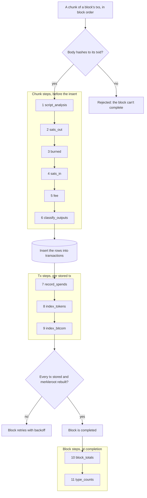

# The tx pipeline

What happens after a transaction comes in.
This doc depicts `Bitblocks.Chain.TxPipeline`; the list in `TxPipeline.steps/0` is the source of truth, and `test/bitblocks/chain/tx_pipeline_doc_test.exs` fails when this doc lists anything else.

Drawn in [TX_PIPELINE.tldr](TX_PIPELINE.tldr).

Related: `docs/SYNCING.md` (how blocks and their txs arrive), `docs/TYPING_PIPELINE.md` (typing: what is built and what comes next), `docs/DERIVED_DATA.md` (each step's version, the stamps on each row, and the backfills).

## Where it runs

`Chain.TxIngest.store_chunk/2` is the only way a transaction is stored.
It takes a chunk of a block's transactions in block order (the sync worker sends 100 at a time) and does this:

1. **Gate:** each body must hash to its txid, or it goes no further.
2. **Chunk steps,** before the insert: columns computed for the whole chunk, so they go in with the row and no row is updated after it.
3. **Insert,** one row per tx, idempotent on the unique txid.
4. **Tx steps,** after the insert, once per stored tx.

`FetchTransactionsWorker` runs the **block steps** once the block is `completed`.
Completion is still decided only by the merkleroot and the stored count, before any block step runs.

A step that raises is logged at error level and reported as the telemetry event `[:bitblocks, :tx_pipeline, :step_failed]`.
A failing tx step rolls its tx back: `TxIngest` runs the insert and the tx steps in one database transaction, so the chunk fails, the block isn't completed, and the retry redoes the whole tx.
That keeps spends, tokens and Bitcom rows from going silently missing.
A failing block step only leaves that block's totals unset.

Plain function calls in order: no process, no queue.

## The steps

Every input's previous transaction is already stored when a tx comes in, because the sync loop fills blocks upward from genesis.
So sats in costs no node call.

### Chunk steps (before the insert)

| # | Step | Reads | Writes | Cost |
| --- | --- | --- | --- | --- |
| 1 | `script_analysis` | the raw tx | `output_types`, `protocols`, `coinbase`, `output_script_hashes`, `output_template_hashes`, `aip_signers`, `script_analysis_version` | CPU: one decode per tx; AIP signature checks only on AIP-tagged txs |
| 2 | `sats_out` | the raw tx | `total_output_satoshis` | CPU: a byte walk, no script parsing |
| 3 | `burned` | the raw tx | `burned_satoshis`: sats in outputs starting `OP_RETURN` or `OP_FALSE OP_RETURN`; 0 when none | CPU: a byte walk |
| 4 | `sats_in` | each input's previous output: from the chunk itself, else stored `transactions.outputs` | `total_input_satoshis`: 0 for a coinbase; nil when any previous output isn't stored | one query per chunk: an index lookup per previous tx, returning one output element per input (Postgres still detoasts that tx's whole `outputs` array to take it) |
| 5 | `fee` | sats in and sats out | `fee_satoshis`: in minus out; 0 for a coinbase; nil when sats in is unknown | CPU only |
| 6 | `classify_outputs` | the raw tx | `tx_types`: the type ids from `types.json` its outputs match (unmatched is `custom`), in `types.json` order; `tx_types_version` | CPU: one tolerant decode (`Chain.RawTx`) and a pattern match per output |

### Tx steps (after the insert)

| # | Step | Reads | Writes | Cost |
| --- | --- | --- | --- | --- |
| 7 | `record_spends` | the tx's inputs | `spend_index`, one row per input; fills order-book listings their inputs settle (once per fill txid; a listing indexed later settles against the row, #40) | one insert per input |
| 8 | `index_tokens` | BSV-20/21 inscriptions, only on txs tagged `BSV20` | `protocol_instances`, the token index | none for untagged txs |
| 9 | `index_bitcom` | Bitcom `$` commands, only on txs tagged `Bitcom` | `bitcom_commands`, with ownership proofs | none for untagged txs |
| 10 | `index_bap` | BAP records, only on txs with a valid AIP signer (`aip_signers`) | `bap_records`: each record whose signature checks; what they mean is worked out when read ([BAP.md](BAP.md)) | none for txs with no AIP signer |

A tx already stored when its block is fetched is skipped, so neither kind of step runs for it.
`Chain.TxPipeline.CatchUp` brings such a block's rows up to version after it completes, every stage included ([DERIVED_DATA.md](DERIVED_DATA.md)).

### Block steps (when the block becomes `completed`)

| # | Step | Reads | Writes | Cost |
| --- | --- | --- | --- | --- |
| 11 | `block_totals` | the block's tx rows | `blocks.sats_out`, `fees`, `miner_reward`, `subsidy`, `burned`, `fees_verified` | one aggregate on the `block_hash` index, one row update |
| 12 | `type_counts` | the block's tx rows | `blocks.type_counts`: type id => txs of that type; `type_counts_version` and `tx_types_version`, only when every tx is typed at the current version (by its own stamp or the block's) | one aggregate on the `block_hash` index, one row update |

`block_totals`:

- `sats_out` sums the non-coinbase outputs, and `burned` sums every tx's burned sats.
- `fees` sums the non-coinbase fees, and is nil when any fee is unknown.
- `miner_reward` is the coinbase's total output.
- `subsidy` comes from height: 50 BTC, halved every 210,000 blocks.
- `fees_verified` is the consistency check, `miner_reward <= subsidy + fees`.
  A miner may claim less than allowed, so a smaller reward still verifies.
  A larger one means our data is wrong, and is logged at error level.
  It is nil while fees are unknown.

`/facts` (`Bitblocks.Facts`, #70) sums these over blocks 0 to the highest height where every block is complete and totalled at the current version: rewards left unclaimed (`subsidy + fees - miner_reward`), burned sats, and a supply audit.
The audit is an identity: the subsidy the schedule issued equals what miners claimed as new coins (`miner_reward - fees`), plus what they left, plus the three coinbases that can never be spent (genesis, and 91,722 and 91,812, overwritten under BIP30).
Those three blocks have no coinbase row, so they never get a `miner_reward` and are left out of the totals check.

### Transaction types

`classify_outputs` (#49 phase 2) runs `Bitblocks.TxTypes.Classifier` on each tx: every output gets one type id from `priv/data/tx_types/types.json`, and the tx's type is the set of them.
An output's type is the first rule that matches:

1. A data output (`OP_RETURN …` or `OP_FALSE OP_RETURN …`) takes the protocol of its first segment: `b`, `map`, `aip`, `sigma`, `metanet`, `run`, else `op-return`.
2. An inscription envelope makes it `bsv-21` or `bsv-20` (a valid token operation), `inscription-map` (a MAP record after the envelope), else `1sat-inscription`.
3. A lock: P2PKH (`1sat-output` when it holds exactly 1 sat), P2PK, P2SH, cosign, bare multisig, `OP_1` alone (`anyone-can-spend`), a STAS token by its contract bytes (`stas`, `Bitblocks.Stas`), or a shape a type lists by template hash (`ordlock`, `timelock`).
4. Anything else is `custom`, so the `custom` count measures what is left to type.

The tx's type also takes the known protocols after a pipe in its data outputs (B then MAP is `b` and `map`).
A MAP record whose `app` is `hodlocker.com` adds `hodlocker`, a post or like backed by a time lock (`Bitblocks.HodLocker`).
Inputs matter in one place: a Metanet node that names a parent counts only when an input is signed with a key, since only the parent's key can add a child; otherwise its output is `op-return`.
Whether that key is the parent's needs the parent tx, so `Bitblocks.Metanet` checks it when it reads the tree, and this step does not.
Each type in `types.json` lists the shared vectors it claims (`vectors`), and `test/bitblocks/tx_types/classifier_test.exs` runs every vector in `output_types_v1.json` through the classifier.

`type_counts` sums the types per block, so `/types` adds up block rows (`Bitblocks.TxTypes.Counts`, cached) instead of counting `transactions`.

## Read-time facts

These change as later blocks come in, so they are computed when read and never stored.

- `Chain.output_status(txid)`: each output is `:unspent` (a UTXO), `:spent` by a named tx and input, `:unknown`, or `:unspendable` (OP_RETURN).
  A tx is a UTXO when any output is unspent.
  Unspent means no stored tx spends it and every block through our tip is synced (`indexed_through_height == tip_height`).
  Short of that, an output with no recorded spend is `:unknown`, because its spend may sit in a block not synced yet.
  The rule, shared with the address and script endpoints, is in `Bitblocks.Chain.Utxos`.
- `Chain.nft_facts(txid)`: whether the tx is an NFT, and whether it is part of a collection.
  An NFT is a 1Sat inscription output (an `OP_FALSE OP_IF "ord"` envelope) or a Run jig (the tx is tagged `Run`).
  A BSV-20/21 inscription is a fungible token, so it doesn't count.
  Collection membership matches the tx's outpoints against `collection_items` by origin (the mint) or current outpoint (where the item is now), and names the collection.
  Two indexed queries: the tx by txid, then `collection_items` by origin and current outpoint.

The tx page (`/transactions/:id`) shows both, with the tallies.
The block page and the homepage's recent blocks show fees and miner reward, and "—" until the block is completed.

## Filling in older blocks

Every step has a version, and each row records which version computed it: `transactions.script_analysis_version`, `transactions.tallies_version`, `transactions.tx_types_version`, `blocks.tallies_version` and `blocks.type_counts_version`.
Types also have a block stamp, `blocks.tx_types_version`: a tx is typed at version N when its own stamp or its block's is N.
Rows from before a step existed, or computed by an older version, are below the current version.
`Release.backfill_tx_tallies(from_height, to_height, opts)`, `Release.backfill_script_analysis(from_height, to_height, opts)` and `Release.backfill_tx_types(from_height, to_height, opts)` run the same step modules over just those rows, in bounded batches in height order, stamp them, and record each run in `derivation_runs`.
The tx types backfill writes only the rows whose types change, and stamps the block for the rest, so a classifier bump that adds a type rewrites only the txs that gain it.
All three are dry runs by default; `apply: true` writes.
`docs/DERIVED_DATA.md` is authoritative for versions, stamps and backfills.

## Adding a step

1. Write one module under `lib/bitblocks/chain/tx_pipeline/steps/` implementing `Bitblocks.Chain.TxPipeline.Step`: `name/0`, a one-line `description/0`, `stage/0`, `version/0`, and `run_chunk/2`, `run/2` or `run_block/1` for its stage.
2. Give it a `version/0` (start at 1), and add it to a derivation in `TxPipeline` if a row should stamp its output.
3. Add one line for it in `@steps` in `Bitblocks.Chain.TxPipeline`, where it should run.
4. Add its row to the table for its stage above, and to the flowchart, and to the step table in `docs/DERIVED_DATA.md`.

A chunk step returns its columns in the row attrs, so they go in with the insert.
A new column on `transactions` is a nullable add in its own migration, with no index in the same change (AGENTS.md, "Migrations on large tables").
