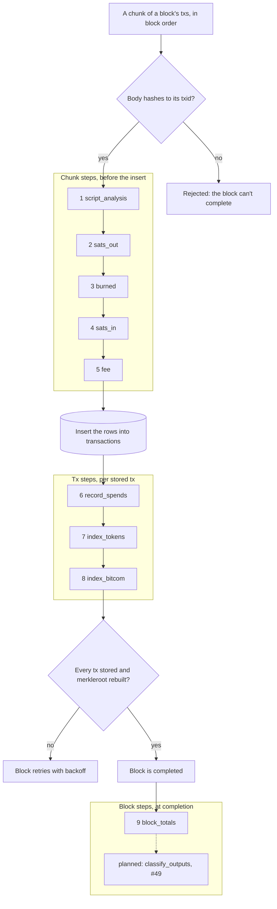

# The tx pipeline

What happens after a transaction comes in.
This doc depicts `Bitblocks.Chain.TxPipeline`; the list in `TxPipeline.steps/0` is the source of truth, and `test/bitblocks/chain/tx_pipeline_doc_test.exs` fails when this doc lists anything else.

Related: `docs/SYNCING.md` (how blocks and their txs arrive), `docs/TYPING_PIPELINE.md` (the typing steps still to come).

## Where it runs

`Chain.TxIngest.store_chunk/2` is the only way a transaction is stored.
It takes a chunk of a block's transactions in block order (the sync worker sends 100 at a time) and does this:

1. **Gate:** each body must hash to its txid, or it goes no further.
2. **Chunk steps,** before the insert: columns computed for the whole chunk, so they go in with the row and no row is updated after it.
3. **Insert,** one row per tx, idempotent on the unique txid.
4. **Tx steps,** after the insert, once per stored tx.

`FetchTransactionsWorker` runs the **block steps** once the block is `completed`.
Completion is still decided only by the merkleroot and the stored count, before any block step runs.

A step that raises is logged at error level and reported as the telemetry event `[:bitblocks, :tx_pipeline, :step_failed]`.
A failing tx step rolls its tx back: `TxIngest` runs the insert and the tx steps in one database transaction, so the chunk fails, the block isn't completed, and the retry redoes the whole tx.
That keeps spends, tokens and Bitcom rows from going silently missing.
A failing block step only leaves that block's totals unset.

Plain function calls in order: no process, no queue.

## The steps

Every input's previous transaction is already stored when a tx comes in, because the sync loop fills blocks upward from genesis.
So sats in costs no node call.

### Chunk steps (before the insert)

| # | Step | Reads | Writes | Cost |
| --- | --- | --- | --- | --- |
| 1 | `script_analysis` | the raw tx | `output_types`, `protocols`, `coinbase`, `output_script_hashes`, `output_template_hashes`, `aip_signers`, `script_analysis_version` | CPU: one decode per tx; AIP signature checks only on AIP-tagged txs |
| 2 | `sats_out` | the raw tx | `total_output_satoshis` | CPU: a byte walk, no script parsing |
| 3 | `burned` | the raw tx | `burned_satoshis`: sats in outputs starting `OP_RETURN` or `OP_FALSE OP_RETURN`; 0 when none | CPU: a byte walk |
| 4 | `sats_in` | each input's previous output: from the chunk itself, else stored `transactions.outputs` | `total_input_satoshis`: 0 for a coinbase; nil when any previous output isn't stored | one query per chunk: an index lookup per previous tx, returning one output element per input (Postgres still detoasts that tx's whole `outputs` array to take it) |
| 5 | `fee` | sats in and sats out | `fee_satoshis`: in minus out; 0 for a coinbase; nil when sats in is unknown | CPU only |

### Tx steps (after the insert)

| # | Step | Reads | Writes | Cost |
| --- | --- | --- | --- | --- |
| 6 | `record_spends` | the tx's inputs | `spend_index`, one row per input; fills order-book listings their inputs settle | one insert per input |
| 7 | `index_tokens` | BSV-20/21 inscriptions, only on txs tagged `BSV20` | `protocol_instances`, the token index | none for untagged txs |
| 8 | `index_bitcom` | Bitcom `$` commands, only on txs tagged `Bitcom` | `bitcom_commands`, with ownership proofs | none for untagged txs |

### Block steps (when the block becomes `completed`)

| # | Step | Reads | Writes | Cost |
| --- | --- | --- | --- | --- |
| 9 | `block_totals` | the block's tx rows | `blocks.sats_out`, `fees`, `miner_reward`, `subsidy`, `burned`, `fees_verified` | one aggregate on the `block_hash` index, one row update |

`block_totals`:

- `sats_out` sums the non-coinbase outputs, and `burned` sums every tx's burned sats.
- `fees` sums the non-coinbase fees, and is nil when any fee is unknown.
- `miner_reward` is the coinbase's total output.
- `subsidy` comes from height: 50 BTC, halved every 210,000 blocks.
- `fees_verified` is the consistency check, `miner_reward <= subsidy + fees`.
  A miner may claim less than allowed, so a smaller reward still verifies.
  A larger one means our data is wrong, and is logged at error level.
  It is nil while fees are unknown.

> **Planned, not built: `classify_outputs`** (#49 phase 2).
> A block step that gives every output a type and every transaction a composite type when the block completes, with anything unmatched as `custom` by its normalized template hash.
> See `docs/TYPING_PIPELINE.md`.
> It joins the list above when it is built.

## Read-time facts

These change as later blocks come in, so they are computed when read and never stored.

- `Chain.output_status(txid)`: each output is `:unspent` (a UTXO), `:spent` by a named tx and input, or `:unspendable` (OP_RETURN).
  A tx is a UTXO when any output is unspent.
  Unspent means no stored tx spends it, so it holds as of the blocks synced so far.
  Two indexed queries: the tx by txid, then `spend_index` by txid.
- `Chain.nft_facts(txid)`: whether the tx is an NFT, and whether it is part of a collection.
  An NFT is a 1Sat inscription output (an `OP_FALSE OP_IF "ord"` envelope) or a Run jig (the tx is tagged `Run`).
  A BSV-20/21 inscription is a fungible token, so it doesn't count.
  Collection membership matches the tx's outpoints against `collection_items` by origin (the mint) or current outpoint (where the item is now), and names the collection.
  Two indexed queries: the tx by txid, then `collection_items` by origin and current outpoint.

The tx page (`/transactions/:id`) shows both, with the tallies.
The block page and the homepage's recent blocks show fees and miner reward, and "—" until the block is completed.

## Filling in older blocks

Blocks completed before these steps existed have empty tally columns.
`Release.backfill_tx_tallies(from_height, to_height, opts)` runs the same step modules over them, in bounded batches in height order.
It is a dry run by default; `apply: true` writes only the rows whose values change, then runs `block_totals` on each block.

## Adding a step

1. Write one module under `lib/bitblocks/chain/tx_pipeline/steps/` implementing `Bitblocks.Chain.TxPipeline.Step`: `name/0`, a one-line `description/0`, `stage/0`, and `run_chunk/2`, `run/2` or `run_block/1` for its stage.
2. Add one line for it in `@steps` in `Bitblocks.Chain.TxPipeline`, where it should run.
3. Add its row to the table for its stage above, and to the flowchart.

A chunk step returns its columns in the row attrs, so they go in with the insert.
A new column on `transactions` is a nullable add in its own migration, with no index in the same change (AGENTS.md, "Migrations on large tables").
