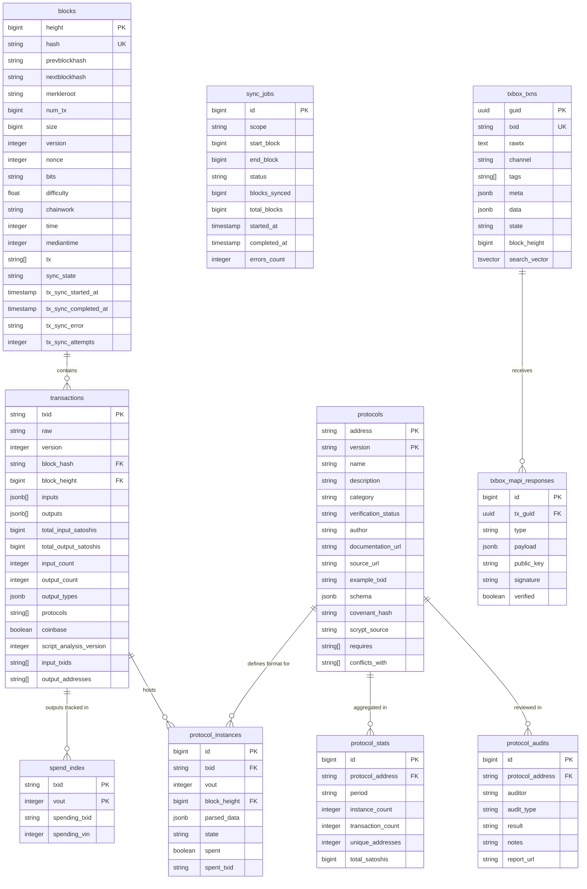

# Data Model

Derived from `/priv/repo/migrations/`.
Each entity corresponds to a concept in `CONCEPT_INVENTORY.md`.

---

## Entity notes

**blocks / transactions** — core ledger.
`blocks.tx[]` is populated only for blocks with ≤10k transactions (memory optimization).
`blocks.sync_state` drives the state machine; see `CONCEPT_INVENTORY.md` for state values.

**spend_index** — absence of a row means the output is unspent (UTXO).
The composite PK `(txid, vout)` is the canonical Outpoint identifier.
`settle_spent_token_utxos/1` joins this table against `protocol_instances` to auto-fill OrderBook listings.

**protocols / protocol_instances** — see *Terminology notes* in `CONCEPT_INVENTORY.md`.
`protocol_instances` doubles as the OrderBook listing store: `parsed_data` carries the listing fields,
`state` tracks `active / filled / cancelled`, and `spent / spent_txid` record settlement.

**txbox_txns** — staged outbound transactions.
Not a blockchain record; used for broadcast management.
`search_vector` is auto-updated by a DB trigger for full-text search over `meta` and `data`.

## Concepts with no DB entity

| Concept | Reason |
|---------|--------|
| Shape Layer | In-memory NFT generation; not persisted |
| DID | Derived from vCard fields at request time |
| MURL | Computed by traversing `protocol_instances` parent chain |
| Spend Depth | Planned (Phase 3); will require a computed column or materialized view |
